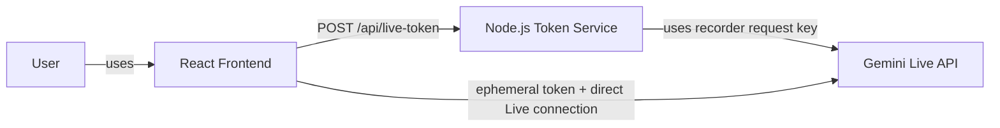
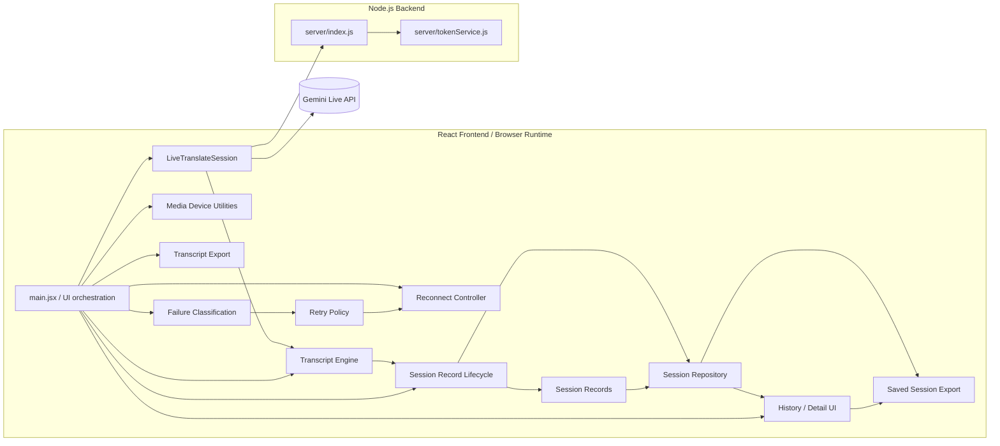
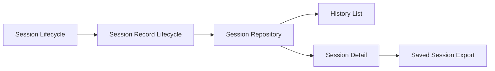

# Architecture Overview

## Issue #41 Host Local-only vertical slice

For local-only Meetings, cloud share metadata authorizes Viewer access and coordinates signaling. The Host DataChannel supplies all Cue snapshots, updates, and replay; Viewer does not require cloud recording Segment or Cue rows.

For a new Host recording, the Meeting and glossary remain cloud settings, while the browser creates the recording Session and Segment in its IndexedDB manifest. The MediaRecorder OPFS chunks, PCM Journal, Cue, transcript, and Checkpoint use existing local durability barriers. Pause and Continue operate on that same local recording identity; Stop and End seal locally before reporting completion. The backend issues an ephemeral Gemini token after Meeting membership authorization without requiring a cloud recording Session or Segment. Rollover drains and seals the old Segment, flushes local Checkpoint and PCM Journal, then commits the successor Segment and operationId together in IndexedDB. Provider readiness resumes audio after the local commit; Reload reads the committed local Segment. Viewer handoff uses Host DataChannel Segment transition and Cue events. No cloud Recording lifecycle reconciliation or mutation is used.

## Issue #41 implementation 1A: PCM failure boundary

Local-only Stop/End completes after MediaRecorder drain, sealed OPFS chunks and IndexedDB manifest, PCM Journal close, and the remaining local durability barriers. Audio decode and multi-Segment WAV composition run only when the Host requests a local download; export failure leaves the sealed recording available for retry until the existing retention deadline. Opening Meeting detail reads audio metadata without composing a Blob. Recording durability and export decodability are separate outcomes.

After capture starts, a Gemini PCM send or provider connection failure leaves the
microphone capture graph and local PCM Journal running. Provider reconnect changes
only the provider connection. A cloud rollover failure before commit resumes the
old provider transition while capture continues. Explicit Stop, microphone loss, and
audio capture failure still release capture resources.

Rejected PCM ranges and failed Journal writes are recorded separately in a host
IndexedDB Gap Ledger (`live-translate-pcm-gaps-v1`). A gap is marked durable only
after its IndexedDB transaction completes; if that write fails, the live status
reports the failure. A queued PCM range is never presented as an OPFS durable
claim until the Journal worker confirms its commit.

## Phase 0 contract delta, 2026-10-01

The browser is the only owner of page storage. It writes immutable audio
chunks to page OPFS, then explicitly sends each chunk to the local service;
the local service must never read page OPFS directly or use browser storage
APIs. The direct browser-to-Gemini path remains separate.

The browser maintains four durable pending queues in IndexedDB: Cue,
checkpoint, operation, and audio. Audio bytes remain in OPFS; its queue stores
the object reference, immutable sequence, range, checksum, and retry state.
Every queue record has an idempotency key, dependency, payload hash, and
version. ACK is valid only after durable commit of the matching key/version.
Lost ACKs are resent with the same key; duplicates return the original result.
Stale fence, version, or hash is a structured conflict, never a silent
overwrite.

Recovery order is fixed: validate queues and checksums, replay lifecycle
operations, replay dependent checkpoints and Cues in sequence/version order,
then replay audio chunks in immutable chunk order. Queues ACK independently,
so audio does not block Cue/checkpoint delivery and those failures do not
discard captured audio. Local Supabase on the recording device is the only
recording lifecycle owner. Cloud Supabase stores only accounts, permissions,
meeting settings, dictionaries, and device/meeting entry data; it is not the
recording-data owner. Browser queues provide delivery and recovery only.

Viewer sharing is read-only and separate from host export permission. Stopping
a Meeting immediately revokes Viewer and Recorder shares; the host retains
completed audio download and TXT/SRT/VTT export for 30 minutes only. Origin
and CORS approval is allowlist-only for approved Preview and Production
origins, with no wildcard or arbitrary localhost approval.

Phase 1 real-device acceptance remains pending: Mac and Windows microphones,
reload/crash queue recovery, OPFS quota/offline resend, audio loss/recovery,
and approved Preview/Production Origin/CORS checks.

## Meeting lifecycle v2

Current expiry policy: `purge_at` is an immutable visibility deadline, not an
automatic deletion trigger. Ordinary users and Viewer shares lose access at the
deadline; active `super_admin` users retain a derived pending-delete metadata
view and may invoke the canonical manual deletion flow. No GET-triggered worker
or Cron physically deletes expired Meeting content. This supersedes older
automatic-cleanup wording retained later in this historical overview.

Supabase is the lifecycle source of truth for new Meetings. A single database
transaction owns each start, pause, resume, rollover, recover, takeover, and
stop transition. Partial transitions cannot be observed by another Vercel
Function invocation.

- A Meeting has at most one open Session and one active Segment.
- The Session ID is stable from start through stop; Segments belong to it.
- A Meeting-scoped recorder lease expires after 10 seconds and uses a monotonic
  fence token so a replaced recorder cannot mutate lifecycle state.
- Lifecycle commands are idempotent by `(meeting_id, operation_id)` and use an
  optimistic `lifecycle_version` for competing commands.
- Recorder liveness is renewed every 3 seconds; Meeting liveness is persisted
  at most once per 30 seconds and retains the 15-minute lost-recorder policy.
- Lost-recorder handling may interrupt a stale active Meeting, but does not
  start the 30-minute countdown. Only successful completion freezes one
  database-generated `ended_at` and `purge_at` per recording. The stable
  `meeting_recordings.id` groups every related Session/rollover Segment;
  provider Session IDs are not recording IDs.
- A protected deletion tombstone and restrictive table/Storage policies reject
  late writes and direct reads after deletion or expiration. Meeting settings,
membership, glossary, and audit history remain until manual deletion.
Before expiry, manual deletion remains owner/super-admin-authorized; after
expiry, only an active super-admin may delete. Cleanup may require several
bounded Storage batches before the Meeting row is removed.
- Expiry does not schedule a cleanup worker or Cron job. Legacy cleanup claim
  RPCs are service-role-only no-ops retained for deployment compatibility.
  Storage deletion uses the Storage API; DB cleanup remains phased and retryable.
  Local OPFS/IndexedDB cleanup uses persisted deadlines and browser locks.
- v2 repository writes leave legacy `sessions.segment_id`,
  `meeting_segments.live_session_id`, and `sessions.transcript_items` empty or
  null while retaining read compatibility for v1 rows.
- Finalized v2 Meeting transcript data is written only to `subtitle_cues`.
  The compatibility Session snapshot retains lifecycle metadata but does not
  receive `transcript_items` appends.
- An audio upload may begin only with the active recorder fence. An artifact
  that already began may complete or fail after the Meeting stops, but not at or
  after its `purge_at` deadline.
- Provider reconnect stays inside the current Segment and retains its provider
  glossary revision. User pause/resume, rollover, and browser-crash recovery
  create Segment boundaries. Resume confirms the authoritative Segment before
  token issuance. Token and Gemini instruction use the Segment-immutable
  provider glossary snapshot. Local deterministic correction has an independent
  SHA-256 revision that hot reloads after a successful glossary save and binds
  each Turn/Cue on first accepted event; refresh failure preserves the last
  confirmed snapshot and never blocks a legal recording resume.

Meetings already active on lifecycle v1 remain on the legacy flow until they
stop. Legacy relationship columns remain readable during that compatibility
window; terminal Meetings are not destructively backfilled.

## 1. Purpose

This document is the high-level architecture entry point for Live Translate.
It is intended for new developers and AI agents who need a fast, accurate map
of the system without reading every feature spec first.

Readers should be able to understand:

- How the browser obtains a Gemini ephemeral token.
- How the browser connects directly to Gemini Live API.
- How audio is captured, chunked, and played back.
- How the canonical source transcript is normalized and reused.
- How future translation outputs relate to the same Session.
- How session lifecycle and reconnect behavior are separated.
- How session history and derived translation data are stored in the
  in-memory repository.
- How saved export reuses transcript formatting.
- How long meetings are represented as Meetings composed from independently
  persisted Segments.

Relevant background docs:

- [README.md](../../README.md)
- [docs/spec.md](../spec.md)
- [docs/architecture.md](../architecture.md)
- [docs/architecture/domain-model.md](domain-model.md)
- [docs/architecture/phase2b-application-foundation.md](phase2b-application-foundation.md)
- [docs/architecture/session-records-architecture.md](session-records-architecture.md)
- [docs/features/session-lifecycle.md](../features/session-lifecycle.md)
- [docs/features/connection-resilience.md](../features/connection-resilience.md)
- [docs/features/session-records-history.md](../features/session-records-history.md)
- [docs/features/better-transcript-handling.md](../features/better-transcript-handling.md)
- [docs/features/transcript-export.md](../features/transcript-export.md)
- [docs/features/audio-device-selection.md](../features/audio-device-selection.md)
- [docs/features/meeting-center-live-viewer.md](../features/meeting-center-live-viewer.md)

## 2. System Context

## P1 identity and data boundary

Supabase Google OAuth uses PKCE in the browser. The backend validates the
Supabase access JWT before private dispatch, including issuer, audience,
expiry, authenticated role, and `AUTH_ALLOWED_EMAIL_DOMAINS`. Matching pending
profiles are conditionally activated by a service-role-only RPC before private
dispatch; disabled profiles are never auto-activated. Profile data is served by
`GET /api/profile`; the service-role key is server-only. P1
Supabase migrations apply owner-scoped composite foreign keys and RLS to all
private tables, and the production composition now wires owner-scoped
Supabase adapters for the supported cloud capabilities. If the required
Supabase configuration is missing or readiness checks fail, cloud APIs remain
fail-closed with `503 cloud_capability_unavailable` or the documented readiness
error.



Browser audio streams are not proxied through the backend.

The backend only issues short-lived ephemeral tokens and enforces the access
gate, origin validation, rate limit, and structured error handling around
`POST /api/live-token`.

P1 applies Supabase JWT validation to private `/api/*` routes. Browsers send
the current Supabase session access token as a Bearer token. Health/readiness
remain public. Supported cloud capabilities use owner-scoped adapters; missing
configuration or an unhealthy dependency keeps those APIs fail-closed.

Current Phase 2A implementation is still a simplified single-output session
model. It uses `SessionRecord`, session-level `targetLanguageCode`,
stream-based source/translation `TranscriptItem` records, a memory repository,
`App.jsx` application composition and cross-feature orchestration, route-level page components under
`src/pages/`, and capability-specific frontend modules under `src/features/`.
Pages own route boundaries while feature modules own feature UI, API clients,
and browser-side orchestration. The independent `LiveRecordingPage` and
Gemini/browser-specific
`LiveTranslateSession`. Hash route parsing is isolated in
`src/app/routes.js`; shared application and public-session shells are provided
by `src/layouts/AppLayout.jsx`. These layout components own presentation
composition only and do not own Session lifecycle or API state.

Session-first implementation now creates a persisted `created` Session before
opening Gemini Live, keeps lifecycle and transcript snapshots keyed by
`sessionId` and `segmentId`, and exposes a read-only Viewer path through opaque
share tokens and per-Session SSE events. The current broadcaster is
process-local; production Meeting Viewer delivery uses Supabase Realtime. Share token
records are file-backed and survive backend restart.

Meeting-first recorder sharing creates a configurable Meeting draft and its
first empty Segment before recording. The creator saves the name, languages,
meeting glossary, translated-audio playback, and original-audio recording
settings in the independent Meeting Settings layout before issuing a Viewer
share link and QR code; the
shared recorder page does not activate the Meeting, create a Session, claim a
lease, or request microphone access until the recipient explicitly starts
recording. Editing settings during recording takes effect at the next Segment
boundary.
The first Session is then created and bound to the empty Segment, after which
the existing recorder grant, lease, checkpoint, and direct Gemini flow apply.

Translation execution status is also available through the authenticated
`/api/sessions/:sessionId/execution-events` WebSocket. A process-local execution
broadcaster publishes safe snapshots after persisted execution create/update
operations, including worker transitions, manual retry, cancellation, and DLQ
related terminal updates. Reconnect performs a REST refetch; there is no event
replay. Cross-process brokers and durable event logs remain out of scope.

Phase 2B target architecture introduces an explicit Application Layer,
repository and provider ports, TranslationRequest / TranslationExecution /
TranslationOutput contracts, read-model contracts, and Compatibility Adapter
mapping. Phase 2C adds saved transcript re-translation, multiple outputs,
retry/cancel/delete, provider selection, and output version UI.

The DLQ administration capability is backend-only: when durable queue storage is
enabled, a protected application service lists the full file-backed DLQ and
creates new queued executions for single-item replay while retaining original
failure records.

The first Phase 2B-2 implementation slice adds `SessionApplicationService` as
the boundary for Session commands and Session read models. Existing repository
and read-model adapters remain responsible for legacy `SessionRecord`
compatibility mapping.

The Meeting Live recorder uses the direct translation path backed by
`LiveTranslateSession` and `gemini-3.5-live-translate-preview`. Gemini returns
source and translation events for the same live Cue. Either side may finalize
and publish independently; a delayed counterpart updates the same `cueId`, while
the existing Session/Meeting checkpoint, rollover, interrupted recovery, and
Viewer ordering remain shared with the recording path. The source-only
`LiveTranscriptionSession` remains available for a future asynchronous
translation pipeline but is not the active Meeting runtime.

Long Meeting support adds a separate Meeting aggregate with ordered
MeetingSegment records. A MeetingSegment may reference an existing Live Session
by `liveSessionId`; compatibility `SessionRecord` snapshots may optionally carry
`meetingId` and `segmentId`. This does not change the browser-to-Gemini audio
path or ephemeral token flow.

Long Meeting proactive segmentation rolls over one active Segment into the next
active Segment while retaining the same logical browser provider session. A
provider WebSocket may be replaced for GoAway or connection loss; the browser
uses the latest session-resumption handle and provisions a fresh single-use
ephemeral token for every replacement Live session.

Final subtitle Cues are stored in the existing file-backed Meeting/Segment
checkpoint. Each finalized Cue keeps raw source/translation values plus
optional versioned refined values and refinement status. Partial Cues, processed
event IDs, and pending boundary state are stored only in the recovery Cue
checkpoint. Session detail reads aggregate final Cues across Segments in
sequence order while preserving legacy transcript fields
for compatibility.

The live UI renders `finalCues` as ordered bilingual rows and derives at most
one trailing partial preview from `currentCue`/`pendingCues`. History and reload
render only `sessionDetail.cues`; when that list is empty, the existing legacy
transcript reading view remains available. The Cue list follows the latest row
until the user scrolls upward, and Pause/Resume/Stop preserve readable Cue
content while terminal sessions reject late partial UI updates.

Long Meeting recovery API support can mark an active Segment as `interrupted`
or `failed` with a final checkpoint. Interrupted recovery creates the next
ordered active Segment for a fresh Live session association. The live UI uses
this path for controlled reconnect after unexpected close or token expiration.
When opened with `#live?meetingId=...`, the live UI reads ordered Segment
checkpoints, restores confirmed transcript content, and lets the user manually
continue recording in the next recovered Segment.

Issue #29 specifies the next Meeting-centered UI boundary and a Meeting-level
Viewer broadcast path. The specification keeps the existing Meeting/Segment
checkpoint as the durable source of complete final Cues, while a process-local
Meeting broadcaster delivers finalized `cue.append` events without waiting for
checkpoint persistence. Viewer reconnect uses a Meeting snapshot plus Cue
cursor merge; it does not change the direct browser-to-Gemini path or Recorder
authorization model. Milestone 5 implements this path with an independent Cue
publish endpoint, bounded in-memory replay, SSE gap recovery, and deterministic
Viewer latency validation. Those SSE/replay details remain only for local
fallback; cloud delivery and durable replay are provided by Supabase Realtime
and persisted Final Cues.

## 3. Runtime Architecture



Dependency direction is intentionally one-way:

- UI orchestration owns cross-page state wiring; page components own route-level
  composition and feature rendering, while Layout components own shared visual
  shells.
- `LiveRecordingPage` owns the independent live-recording surface; the
  Meeting Workspace owns history, glossary, sharing, and saved export views.
- LiveTranslateSession owns one low-level browser-to-Gemini session attempt.
- Transcript Engine owns normalization of transcript items.
- Session Record Lifecycle maps session state into record updates.
- Session Repository hides storage details behind a stable boundary.
- Saved Session Export reuses transcript formatting instead of duplicating it.

Phase 2B target dependency direction:

```text
React UI / REST API / Worker
            |
            v
Application Services
            |
            v
Domain Model and Policies
            |
            v
Ports
            |
            v
Infrastructure Adapters
```

Phase 2B migration is incremental. Existing helpers may first be wrapped by
Application Services. React components should no longer directly own repository
writes, session finalization, translation execution, or export orchestration
once the Phase 2B-2 skeletons exist.

## 4. Core Runtime Flow

Normal session flow:

```text
User Start
→ Microphone permission
→ Input device selection
→ Request ephemeral token
→ Connect Gemini Live
→ Stream PCM audio
→ Receive translated audio/transcripts
→ Update transcript state
→ Append finalized transcript items to active SessionRecord
→ User Stop / terminal state
→ Finalize SessionRecord
→ Refresh in-memory history
→ View detail / export
```

The active session and saved history remain separate. The active session keeps
running independently of history rendering, and saved history is a read-only
view of finalized records.

### Translation Execution Async Runtime

`POST /api/translation-executions` is an asynchronous submission endpoint. The
HTTP request path creates and queues execution work, but it does not wait for
provider execution and does not create `TranslationOutput`.

```text
HTTP
↓
TranslationCommandService
↓
TranslationExecutionQueue
↓
TranslationExecutionWorkerRuntime
↓
TranslationExecutionWorker
↓
TranslationExecutionRunner
↓
TranslationExecutionProvider
```

Submission flow:

```text
POST /api/translation-executions
↓
persist created
↓
persist queued
↓
enqueue job
↓
202 Accepted
```

Worker processing flow:

```text
TranslationExecutionWorkerRuntime
↓
check TranslationExecutionQueue.size()
↓
TranslationExecutionWorker
↓
dequeue one job
↓
load TranslationExecution
↓
load TranslationRequest
↓
TranslationExecutionRunner
↓
TranslationExecutionProvider
↓
completed / failed
```

Success lifecycle:

```text
created
→ queued
→ running
→ completed
```

Failure lifecycle:

```text
created
→ queued
→ running
→ failed
```

### Execution Control

`cancelled` is a terminal TranslationExecution status. The cancellation
transition is only `queued → cancelled`; it is unavailable for `running`,
`completed`, `failed`, and already `cancelled` executions. It is not a
provider-side abort, and a cancelled execution never enters running, completed,
or failed or creates a TranslationOutput.

Manual retry is available only for a failed execution. It does not mutate the
source: a new queued execution is created with a new execution ID and provider
idempotency identity, while retaining the source request identity and
providerKey. Its actual work remains owned by the existing Worker/Runtime.

Cancellation does not directly remove active or durable queue items. Any
remaining identifier-only item is a safe Worker/recovery no-op: it does not
resolve or call a provider, run the Runner, create output, schedule retry, or
transfer to the DLQ. Durable claim, lease, fence, and acknowledgement ownership
rules remain in force.

Runtime boundaries:

- `TranslationExecutionQueue` is an infrastructure-independent application
  boundary. Its contract is `enqueue(item)`, `dequeue()`, and `size()`. The
  default adapter is deterministic in-memory FIFO.
- Queue jobs contain only `executionId` and `requestId`.
- `TranslationExecutionWorkerRuntime` is a polling adapter. It exposes
  `start()`, `stop()`, and `isRunning()`, prevents reentrant `processNext()`
  calls, and keeps polling after worker errors.
- `start()` begins one Worker Loop. Repeated `start()` calls do not create
  additional loops.
- The Worker Loop checks `queue.size()` before invoking the Worker. Empty
  queues wait for the next scheduled poll without executing idle worker work.
- Newly enqueued jobs are picked up on later polls without restarting the
  Runtime. A running Runtime processes jobs one at a time in FIFO order.
- `stop()` prevents future polling and new queue work, but it does not cancel an
  in-flight `TranslationExecutionWorker.processNext()` call. The current
  execution can finish normally; the Runtime reports stopped after that work
  completes.
- Restart after stop resumes processing remaining queued work.
- `TranslationExecutionWorker` processes one queue job per `processNext()` call.
- Queue and Worker are decoupled: submission only enqueues, and worker
  processing loads persisted objects by identifier before delegating to
  `TranslationExecutionRunner`.
- Production composition creates the queue, runner, worker, and Worker Runtime,
  but production startup does not automatically start the Worker Runtime.
- Production integration coverage verifies `POST -> queued`, queued execution
  processing through Worker, Runtime start of existing queue work, Runtime stop
  preserving newly queued work, Runtime restart processing remaining FIFO work,
  and completed / failed lifecycle persistence through the production runner and
  provider path.

### Durable Queue Components

Phase 3C adds a feature-gated durable queue foundation around the existing
in-memory execution queue. It does not replace Worker processing, execution
lifecycle, provider execution, or HTTP behavior.

Components:

- `TranslationExecutionQueue`: application queue port used by Translation
  Command submission, Worker, Worker Runtime, and composition. Jobs contain
  `executionId` and `requestId`.
- `DualWriteTranslationExecutionQueue`: infrastructure adapter used only when
  the durable queue feature is enabled. It writes a durable queue item first and
  then enqueues the existing active in-memory queue.
- `DurableTranslationExecutionQueueRepository`: application repository port for
  durable queue storage. Its contract is `enqueue`, `peek`, `list`, `dequeue`,
  `size`, `clear`, `updateStatus`, system `acknowledge`, lease-aware
  `acknowledgeClaim`, `contains`, and `claim`.
- `FileDurableTranslationExecutionQueueRepository`: JSON file-backed durable
  repository adapter. It stores FIFO items with `executionId`, `requestId`, and
  ISO UTC `enqueuedAt`, plus durable queue item `status`.
- `StartupTranslationExecutionQueueRecovery`: application service that replays
  durable queue items into the active in-memory queue before Worker Runtime
  polling starts.

Durable queue item statuses are centralized and limited to `queued`,
`processing`, `completed`, and `failed`. New durable queue items default to
`queued`; older persisted items without `status` load as `queued`, while
unknown statuses fail storage validation. These statuses do not change the
`TranslationExecution` domain lifecycle.

Phase 3E adds six aligned duplicate-protection boundaries while retaining the
queue contract, FIFO semantics, and HTTP `202 Accepted` response:

1. `executionId` is the durable and active queue identity. The same
   `requestId` is idempotent; a different request ID fails with
   `translation_execution_queue_item_conflict`.
2. Durable enqueue preserves the original item and its persisted metadata.
3. Active in-memory enqueue retains at most one active item per execution until
   dequeue.
4. Startup recovery filters durable state and can replay the same FIFO batch
   repeatedly without duplicate active work.
5. The Worker guards persisted execution lifecycle before claim or provider
   execution.
6. `TranslationOutput` persistence retains the first output for an execution.

| Execution / durable state | Behavior |
| --- | --- |
| `queued` | Recovery may replay it in FIFO order; the Worker may claim and execute it. |
| `processing` | An active `leaseExpiresAt` remains durable and is not replayed. An expired lease is cleared and reclaimed through `queued`; recovery then checks execution and output state before replay or terminal reconciliation. |
| `completed` | Recovery does not replay it; the Worker skips a completed execution. |
| `failed` | Recovery does not replay it; startup acknowledges only a failed execution with no output. The Worker skips a failed execution. |
| `cancelled` | Recovery and the Worker treat it as a terminal no-op and acknowledge it without provider or output work. |
| `created` / `running` execution | The Worker skips it and does not invoke the provider. |

Provider attempt state is independent of the execution state:
`not_started → in_flight → succeeded | failed`. A successful provider result is
persisted before output and completion. Recovery reconciles `succeeded` with a
valid result snapshot without calling the provider. Expired `in_flight` work is
replayed only for a provider declaring `idempotency.mode: guaranteed`; `unknown`
and `unsupported` retain the durable item. Gemini remains `unknown` even though
it receives `metadata.idempotencyKey`.

Lease ID and fence token protect attempt snapshot, output, completion, and
acknowledgement writes from stale owners.

Feature flags:

- `DATA_DIR`: default directory for file-backed persistence. It defaults to
  `./data` outside production and `/var/data` in production.
- `TRANSLATION_DURABLE_QUEUE_ENABLED`: disabled by default. When set to `true`,
  production composition enables dual-write enqueue persistence and startup
  recovery.
- `TRANSLATION_DURABLE_QUEUE_FILE`: optional file path for the file-backed
  durable queue repository. When omitted, the default file is
  `translation-execution-queue.json` under `DATA_DIR`.

Feature-enabled enqueue flow:

```text
POST /api/translation-executions
↓
persist created
↓
persist queued
↓
DualWriteTranslationExecutionQueue.enqueue()
↓
DurableTranslationExecutionQueueRepository.contains(executionId)
↓
DurableTranslationExecutionQueueRepository.enqueue()
↓
InMemoryTranslationExecutionQueue.enqueue()
↓
202 Accepted
```

Startup sequence:

```text
Worker Startup
↓
StartupTranslationExecutionQueueRecovery.recover()
↓
Replay Durable Queue
↓
Claim Durable Queue Item
↓
TranslationExecutionWorkerRuntime.start()
↓
Worker Polling
```

Replay flow:

```text
DurableTranslationExecutionQueueRepository.list()
↓
InMemoryTranslationExecutionQueue.enqueue({ executionId, requestId })
↓
repeat once per executionId
```

Worker claim flow:

```text
TranslationExecutionQueue.dequeue()
↓
load TranslationExecution and TranslationRequest
↓
DurableTranslationExecutionQueueRepository.claim(executionId, { leaseId, leaseExpiresAt })
↓
heartbeat renewal + TranslationExecutionRunner.run() fenced by leaseId + fenceToken
↓
DurableTranslationExecutionQueueRepository.acknowledgeClaim(executionId, { leaseId, fenceToken })
```

The claim happens only when the durable queue feature is enabled and the Worker
has a durable queue repository. The runner starts only after claim succeeds.

Durable queue items remain stored through startup recovery and runner
execution. The Worker removes an item only after the Runner has persisted
`completed` or `failed`, through `acknowledgeClaim(executionId, { leaseId, fenceToken })`.
Startup terminal reconciliation uses system `acknowledge(executionId)` without
a Worker lease; acknowledgement errors retain the item.

Each claim increments `fenceToken`. If L1 expires, recovery requeues it and L2
claims token `N + 1`; L1's late output, terminal persistence, and acknowledgement
are rejected while L2 retains ownership.

Recovery replays queued items in FIFO order. An active processing lease remains
unchanged. An expired processing item has its old lease cleared and returns to
queued before recovery loads execution and output state for replay or terminal
reconciliation. A queued execution follows the normal requeue path; an
output-less running execution uses its explicit domain recovery transition to queued first.
An output-bearing running execution instead uses the command-service completed
transition, marks the durable item completed, and acknowledges it without
provider replay. A completed execution with output and an expired processing
item likewise finalizes its durable item. Terminal failed, missing, mismatched,
and active-lease items remain in storage. A durable completed item is
acknowledged at startup only when its execution is completed and has output.
An expired processing item with a failed execution and no output retries its
claim-guarded DLQ transfer without provider replay or rewriting execution
failure metadata. DLQ persistence is idempotent by `executionId` and precedes
durable-item removal.
Conflicting persisted identities fail before replay.

The Worker loads persisted execution and request records before durable claim or
provider execution. Only queued executions proceed; created, running, completed,
failed, and cancelled executions return an `execution_not_processable` skip result without
changing durable queue state or execution lifecycle.

For an owned transient provider failure that remains below the queue retry
limit, the Worker stores retry metadata, releases the durable item back to
`queued`, and transitions the execution from `running` to `queued`. Terminal
failures are persisted before a claim/fence-checked DLQ transfer. Runtime delay
scheduling uses the earliest durable `availableAt`.

Translation output persistence is idempotent by execution ID. The first stored
output remains authoritative; subsequent create attempts return it without
overwriting output content or metadata.

Current limitations:

- Completed reconciliation requires a persisted output; recovery does not infer
  success for missing-output or mismatched execution/durable state.
- Failed reconciliation requires no output and leaves output-bearing failed
  executions durable.
- No multi-worker locking or cross-process deduplication policy.
- These layers do not provide multi-process exactly-once delivery.
- Provider-level external idempotency keys and event-publishing deduplication
  remain out of scope.

Queue observability is process-local. The shared metrics registry is injected
into the Worker, Worker Runtime, and startup recovery and is read through the
authenticated `GET /api/metrics` endpoint. It intentionally uses fixed
low-cardinality names and does not persist or expose execution/provider
identifiers.

## 5. Authentication and Token Flow

- Live token issuance uses only the authenticated recorder's request-scoped
  key. `GEMINI_API_KEY`, when configured, is isolated to non-Live workers.
- The browser receives only a short-lived ephemeral token.
- `POST /api/live-token` keeps its access gate, origin validation, rate limit,
  and structured error handling.
- Segment rollover and provider reconnect request a fresh `/api/live-token`
  credential because replacement Live sessions use single-use tokens.
- Ephemeral tokens must never be written to logs.

The browser should not hold any long-lived secret or backend credential.

## 6. Audio Pipeline

Input path:

```text
getUserMedia
→ selected input device
→ AudioContext
→ ScriptProcessorNode
→ PCM16 16kHz mono chunks
→ Gemini Live API
```

Output path:

```text
Gemini PCM16 24kHz
→ decode
→ AudioBuffer
→ AudioBufferSourceNode
→ AudioContext.destination
```

Notes:

- `ScriptProcessorNode` is deprecated.
- `AudioWorklet` migration is deferred.
- Output device selection is browser-limited and deferred.
- Audio never traverses the backend proxy path.

## 7. Transcript Engine

Transcript handling is split into source and translation streams and is
normalized before it reaches UI, history, or export.

```text
Gemini Event
→ LiveTranslateSession mapping
→ Transcript Engine
→ UI
→ Session Record Lifecycle
→ Repository
→ Export
```

Rules:

- Source and translation streams stay separate.
- The current implementation treats the source stream as the canonical text
  source for the active session.
- Partial updates replace the current partial item.
- Final updates commit a stable item.
- Duplicate partial or final updates are suppressed.
- Ordering is preserved with a stable sequence.
- Empty transcript text is ignored.
- `TranscriptItem` is the source of truth for history and export.

The transcript engine must not know about repositories, rendering, or token
issuance.

## 8. Session Lifecycle

High-level states:

- `idle`
- `requesting-permission`
- `connecting`
- `listening`
- `reconnecting`
- `stopping`
- `stopped`
- `error`
- `expired`

Session Lifecycle defines state, transition, cleanup, and UI mapping rules. It
does not own audio details or reconnect policy.

Important boundaries:

- `user_stop` is an expected close path.
- `unexpected_close` may enter controlled reconnect.
- `Connection Resilience` builds on this lifecycle model.
- `Connection Resilience` does not replace lifecycle cleanup or state mapping.

See [Session Lifecycle Management](../features/session-lifecycle.md) for the
transition model and cleanup policy.

## 9. Connection Resilience

Completed slices:

- Failure Classification
- Retry Policy
- Reconnect Controller
- Failure Signal Integration
- Controlled reconnect for `unexpected_close`
- Retry exhaustion UX
- Failure-state mapping
- Manual recovery UX

Not supported as automatic reconnect paths:

- `token_expired`
- `network_offline`
- `provider_error`
- microphone / device failure

Responsibility split:

- `ReconnectController` owns retry timing, generation guard, cancellation, and
  stale callback protection.
- `LiveTranslateSession` owns one low-level Gemini / audio session attempt.
- `main.jsx` owns the adapter that creates replacement sessions and preserves
  transcript and session-record state.

See [Connection Resilience](../features/connection-resilience.md) for the
failure matrix and enabled reconnect scope.

## 10. Session Records and History

The session-record boundary turns a live session into a read-only history item
without changing the live Gemini flow.



Rules:

- `SessionRecord` is the current Phase 2A storage and compatibility shape, not
  the canonical Phase 2B target aggregate.
- `TranscriptItem[]` currently belongs to the record.
- `SessionRepository` is the current storage abstraction.
- `MemorySessionRepository` is the current runtime adapter.
- The current implementation still maps one SessionRecord to one active target
  language output.
- The Phase 2B target model splits the canonical SourceTranscript from the
  Translation aggregate.
- Listening creates the active record.
- `stopped`, `error`, and `expired` finalize the record.
- Reconnect keeps the same logical `SessionRecord`.
- Manual Start creates a new record.
- History only shows terminal sessions.

Phase 2B target aggregate boundary:

```text
Session Aggregate
├── Session
└── SourceTranscript

Translation Aggregate
├── TranslationRequest
├── TranslationExecutions
└── TranslationOutput
```

The aggregates are connected by identifiers:

```text
TranslationRequest.sessionId
TranslationRequest.sourceTranscriptRevisionId
```

Session detail is an Application Read Model composed from Session and
Translation data. Legacy `SessionRecord` data should be projected through a
Compatibility Adapter in repository implementation or read-model mapper.

See [Session Records & Translation History](../features/session-records-history.md)
and [Session Records Architecture](session-records-architecture.md).

## 11. Phase 4B Translation History Boundary

Session re-translation derives immutable source input from the saved canonical
transcript and submits a new request/execution asynchronously. Completed
`TranslationOutput` records remain formal, versioned results: versions are
monotonic per `(sessionId, targetLanguageCode)`, while an output is idempotent
per execution. Each completed re-translation also materializes a separate
completed retranslation `SessionRecord` for the history list, with provenance
back to the original speech Session, request, execution, and output.

Queue items remain identifier-and-claim records; request persistence owns source
text, target language, and provenance. Worker/recovery reload request state by
`requestId`; lease/fence checks guard output, terminal state, and acknowledgement
writes. Reclaim safety is local persistence safety, not a Gemini remote
deduplication guarantee. Failed terminal work produces no output and DLQ
transfer never calls a provider.

The detail UI keeps pending/failed re-translation executions on the original
speech Session while completed re-translation articles appear as their own
history records. It prevents stale responses from replacing newer
session/refresh state and exports the selected record as TXT/SRT/VTT.
Legacy-only Sessions retain their existing read-only fallback and exporter.

## 12. Export Architecture

There are two export paths.

Active Session Export:

```text
Transcript State
→ transcriptExport.js
→ TXT / SRT / VTT
```

Saved Session Export:

```text
SessionRepository detail
→ sessionRecordExport.js
→ transcriptExport.js
→ TXT / SRT / VTT
```

Export rules:

- TXT supports `source`, `translation`, or `both` for the current
  single-output representation.
- SRT and VTT support one stream at a time.
- Timing uses frontend observation timestamps.
- Saved export uses `sessionRecord.startedAt` as `timeOrigin`.
- Future saved export should support SourceTranscript plus multiple
  TranslationOutput records without changing canonical data.

Saved export must reuse existing formatting rules instead of reimplementing
them.

## 12. Module Responsibility Table

| Module | Responsibility | Must Not Own |
| ------ | -------------- | ------------ |
| `src/app/App.jsx` | Cross-feature composition, existing session wiring, and route view composition | Gemini SDK internals, repository implementation, export formatting rules |
| `src/features/live/*` | Live-specific audio/transcript helpers and browser-side feature orchestration | Route parsing, unrelated Meeting or Glossary state |
| `src/pages/live/LiveRecordingPage.jsx` | Independent live-recording page surface and route boundary | Session lifecycle implementation, repository persistence, Gemini SDK internals |
| `src/features/*` | Capability-specific frontend UI, API clients, and browser-side feature orchestration | Route parsing, backend domain rules, unrelated feature state |
| `src/app/routes.js` | Hash route parsing and canonical URL normalization | Session lifecycle, data fetching, rendering |
| `src/layouts/AppLayout.jsx` | Shared application, meeting, and public-session shells | Feature state, API calls, Session lifecycle |
| `SessionApplicationService` | Phase 2B target session use-case boundary for create/start/reconnect/stop/complete/fail/list/detail | React rendering, Gemini SDK internals, legacy `SessionRecord` storage shape |
| `TranslationApplicationService` | Phase 2B target translation request, execution, retry/cancel/delete contract boundary | Provider SDK details, React rendering, compatibility mapping |
| `ExportApplicationService` | Phase 2B target export orchestration for SourceTranscript, TranslationOutput, and combined Session view | Repository implementation, file-format internals, live audio |
| `LiveSpeechTranslationPort` | Phase 2B target provider port for realtime speech translation | Repository writes, UI state, saved transcript translation lifecycle |
| `SavedTranscriptTranslationPort` | Phase 2B target provider port for saved transcript translation | Microphone/audio lifecycle, WebSocket-only assumptions, UI state |
| `liveSession.js` | One low-level Gemini/audio session attempt, microphone capture, audio playback, event forwarding | Repository logic, history state, retry policy, durable storage |
| `transcript.js` | Normalize transcript items, preserve stream separation, partial/final handling, stable ordering | Repository access, UI layout, token flow, export file generation |
| `transcriptExport.js` | Format active-session transcript data into TXT, SRT, and VTT | Repository access, live session control, history mutation |
| `mediaDevices.js` | Input-device enumeration helpers, browser constraints, output-capability detection | Token issuance, transcript state, history storage |
| `connectionFailures.js` | Classify failure reasons into stable categories | Retry timing, reconnect orchestration, UI rendering |
| `retryPolicy.js` | Decide retry timing and attempt limits | Gemini SDK, audio graph, repository, UI state ownership |
| `reconnectController.js` | Cancellation, generation guard, retry scheduling, stale callback protection | Gemini SDK, `AudioContext`, transcript normalization, repository internals |
| `failureUiState.js` | Map classified failures to user-facing UI state | Retry policy, repository, token issuance, audio capture |
| `sessionRecords.js` | Session-record domain model, transcript-summary logic, record lifecycle primitives | React UI, storage engine selection, reconnect control |
| `sessionRepository.js` | Repository boundary and in-memory adapter for records and transcript items | UI rendering, token issuance, audio streaming, Gemini integration |
| `sessionRecordLifecycle.js` | Map lifecycle changes into record create/append/finalize actions | Reconnect policy, export formatting, repository implementation details |
| `sessionRecordExport.js` | Build saved-session export inputs, validation, and file names | Repository mutation, live audio, Gemini SDK access |
| `server/index.js` | HTTP routing, auth/access gate, origin validation, rate limit, structured errors | Audio streaming, transcript state, frontend UI logic |
| `server/tokenService.js` | Validate token request shape and create Gemini ephemeral token config | HTTP routing, CORS policy, UI state, audio relay |

## 13. Dependency Rules

- Transcript Engine does not depend on Repository.
- Repository does not depend on React or UI rendering.
- ReconnectController does not depend on Gemini SDK, `AudioContext`, or the
  Transcript Engine.
- Session Records do not control reconnect.
- UI does not directly hold `GEMINI_API_KEY`.
- Backend does not process audio streaming.
- Saved export reuses the existing formatter instead of duplicating format
  rules.
- Any future durable storage adapter must obey the existing repository
  boundary.
- Application Services must not depend on the legacy `SessionRecord` storage
  shape.
- Compatibility Adapter belongs in repository implementation or read-model
  mapper, not in Application Service.
- Translation execution failure does not affect Session status.
- Provider socket close, microphone disconnect, and browser suspend must be
  classified by the Application Layer before any domain lifecycle transition.

## 14. Phase 2B Foundation Contracts

Phase 2B-1 defines contracts only. Phase 2B-2 may implement skeletons, ports,
compatibility adapters, and read-model wrappers.

Application services:

- `SessionApplicationService`
- `TranslationApplicationService`
- `ExportApplicationService`

Repository ports:

- `SessionRepository`
- `TranslationRepository`

Provider ports:

- `LiveSpeechTranslationPort`
- `SavedTranscriptTranslationPort`

Deferred provider port:

- `SpeechSynthesisPort`

Formal translation model:

```text
TranslationRequest
    |
    +-- TranslationExecution 1..n
    |
    +-- TranslationOutput 0..1 successful result
```

Application read models:

- `SessionHistoryListItem`
- `SessionDetailDTO`
- `TranslationOutputSummaryDTO`
- `TranslationOutputDetailDTO`
- `TranslationRequestDTO`
- `TranslationExecutionDTO`

Lightweight Phase 2B-1 domain event contracts:

- `SessionCreated`
- `SessionCompleted`
- `SessionFailed`
- `SourceTranscriptFinalized`
- `TranslationRequested`
- `TranslationExecutionStarted`
- `TranslationExecutionFailed`
- `TranslationOutputCreated`

These are not Event Sourcing, broker, replay, persisted event history, or outbox
contracts.

Authenticated cloud CRUD carries an explicit request scope containing the actor,
resource owner, access token, and capability. `user` requests use the caller
JWT with the publishable Supabase key even when the actor is an assigned member;
`worker`, `admin`, and `readiness` capabilities are the only service-role paths.
If a user-scoped client is unavailable, the API fails closed with
`cloud_capability_unavailable` and does not fall back to file storage or a
service-role request.

## 15. Current Storage Model

Current state:

- Supabase cloud mode stores owner-scoped Meetings, Segments, Sessions, Final
  Cues, shares, audio metadata, glossary data, translation queue/DLQ records,
  recorder leases, execution status, meeting events, and observability metrics
  under RLS or service-role-only RPC boundaries as appropriate.
- Original Segment audio is WebM/Opus uploaded by browser TUS directly to the
  private `meeting-audio` bucket; Vercel handles metadata and signed URLs only.
- Final Cue writes trigger private Supabase Realtime broadcasts, so production
  does not require process-local Meeting event state.
- Local Node development retains file-backed repositories, segmented WAV
  artifacts, and SSE for compatibility.

- Backend server runtime uses a JSON file-backed SessionRepository by default at
  `session-records.json` under `DATA_DIR`.
- `SESSION_RECORDS_FILE` overrides the default file path when configured.
- File-backed session storage preserves saved sessions, transcript items, and
  translation command state across page refresh and server restart.
- No `localStorage`.
- No `IndexedDB`.
- Cloud persistence is database-backed; file-backed adapters are local fallback.

The file-backed adapter is intended for the current single-node internal-tool
scope. It is not a multi-process locking or production database substitute.

If browser-local durable storage is introduced later:

- Evaluate `IndexedDB` first.
- Use epoch milliseconds for timestamps.
- Define retention, delete, and migration policy up front.

## 16. Security and Privacy Boundaries

Do not store or log:

- `GEMINI_API_KEY`
- ephemeral token
- raw SDK stack traces
- authentication secret
- raw audio
- transcript content in logs

Additional boundary rules:

- Transcript content may contain sensitive information.
- Current transcript history exists only in browser runtime memory.
- Backend storage is not enabled.
- Future server-side history must introduce access control before storing
  transcript data.

## 17. Testing Architecture

Unit tests cover:

- Transcript engine
- Export formatting
- Media device helpers
- Failure classification
- Retry policy
- Reconnect controller
- Session records, repository, lifecycle, and export helpers

E2E tests cover:

- Start / Stop
- Reconnect
- Failure UX
- History list
- Session detail
- Saved export

Real Gemini validation is opt-in only and should not run as part of normal
automated test execution.

See [docs/TESTING.md](../TESTING.md) for the test split and available commands.

## 18. Completed Capability Snapshot

Phase 2A completed capabilities:

- Transcript Engine
- Active Transcript Export
- Audio Input Device Selection
- Session Lifecycle
- Connection Resilience Phase 1
- Session Records Domain
- Memory Repository
- Lifecycle Mapping
- History List
- Session Detail
- Saved Session Export

The current implementation remains a simplified single-output representation
of the future domain model.

## 19. Deferred Architecture

Intentionally deferred:

- Durable storage
- IndexedDB adapter
- Backend persistence
- Access Control v1
- Search
- Bookmarks
- Usage Metrics
- Diagnostics dashboard
- Token refresh
- Broader reconnect reasons
- Audio output selection
- AudioWorklet migration
- Event outbox
- Broker
- Event replay
- Raw audio storage
- Text-to-speech regeneration
- Billing
- Multi-tenancy
- Production deployment concerns

## 20. Terminology

Canonical Phase 2B target terms:

- Session-oriented Real-time Multilingual Translation Platform
- Application Layer
- SourceTranscript
- TranslationRequest
- TranslationExecution
- TranslationOutput
- Compatibility Adapter

`TranslationJob` is not a canonical domain entity. It may appear only as current
proposal history, legacy naming, or transitional compatibility alias and must be
labelled as non-target terminology.

## 21. Phase 4A Closeout

Phase 4A adds allowlisted persisted target languages, optional canonical
mixed-language source detection metadata, provider-instruction-only file
glossaries, and session-scoped translation history reads. The history UI is a
read model: it displays requests, execution state, outputs, and available
detection metadata without starting translation work.

Gemini's actual translation and language-detection quality remains a manual
environment validation concern. There is no account/authorization layer,
glossary management UI/API, or cross-session history.

## 22. Related Documentation

- [README.md](../../README.md)
- [AGENTS.md](../../AGENTS.md)
- [CONTRIBUTING.md](../../CONTRIBUTING.md)
- [docs/ROADMAP.md](../ROADMAP.md)
- [docs/spec.md](../spec.md)
- [docs/architecture.md](../architecture.md)
- [docs/architecture/domain-model.md](domain-model.md)
- [docs/architecture/phase2b-application-foundation.md](phase2b-application-foundation.md)
- [docs/architecture/session-records-architecture.md](session-records-architecture.md)
- [docs/features/session-lifecycle.md](../features/session-lifecycle.md)
- [docs/features/connection-resilience.md](../features/connection-resilience.md)
- [docs/features/session-records-history.md](../features/session-records-history.md)
- [docs/TESTING.md](../TESTING.md)
- [docs/releases/v0.6.0-foundation.md](../releases/v0.6.0-foundation.md)
- Meeting Viewer production delivery now stores sanitized finalized Cue events in owner-scoped Supabase `meeting_events`; reconnect replays events after the prior cursor before applying buffered Realtime broadcasts. Local SSE remains the development fallback.
