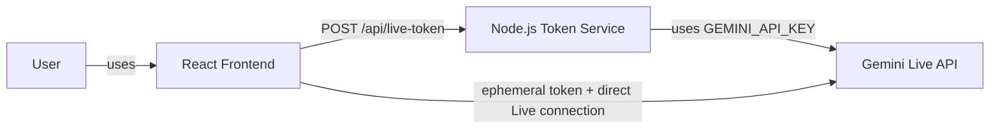
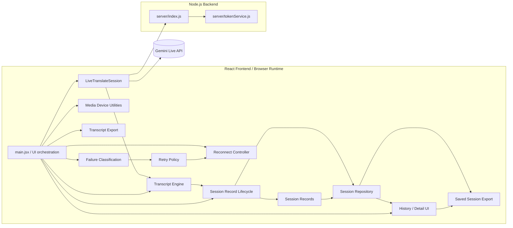
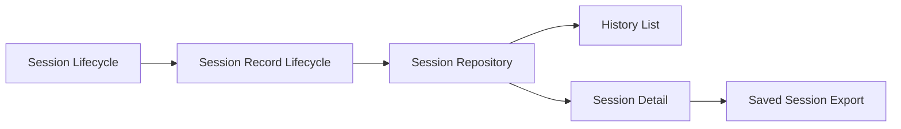

# Architecture Overview

## 1. Purpose

This document is the high-level architecture entry point for Live Translate.
It is intended for new developers and AI agents who need a fast, accurate map
of the system without reading every feature spec first.

Readers should be able to understand:

- How the browser obtains a Gemini ephemeral token.
- How the browser connects directly to Gemini Live API.
- How audio is captured, chunked, and played back.
- How transcript state is normalized and reused.
- How session lifecycle and reconnect behavior are separated.
- How session history is stored in the in-memory repository.
- How saved export reuses transcript formatting.

Relevant background docs:

- [README.md](../../README.md)
- [docs/spec.md](../spec.md)
- [docs/architecture.md](../architecture.md)
- [docs/architecture/session-records-architecture.md](session-records-architecture.md)
- [docs/features/session-lifecycle.md](../features/session-lifecycle.md)
- [docs/features/connection-resilience.md](../features/connection-resilience.md)
- [docs/features/session-records-history.md](../features/session-records-history.md)
- [docs/features/better-transcript-handling.md](../features/better-transcript-handling.md)
- [docs/features/transcript-export.md](../features/transcript-export.md)
- [docs/features/audio-device-selection.md](../features/audio-device-selection.md)

## 2. System Context



Browser audio streams are not proxied through the backend.

The backend only issues short-lived ephemeral tokens and enforces the access
gate, origin validation, rate limit, and structured error handling around
`POST /api/live-token`.

## 3. Runtime Architecture



Dependency direction is intentionally one-way:

- UI orchestration owns composition and state wiring.
- LiveTranslateSession owns one low-level browser-to-Gemini session attempt.
- Transcript Engine owns normalization of transcript items.
- Session Record Lifecycle maps session state into record updates.
- Session Repository hides storage details behind a stable boundary.
- Saved Session Export reuses transcript formatting instead of duplicating it.

## 4. Core Runtime Flow

Normal session flow:

```text
User Start
→ Microphone permission
→ Input device selection
→ Request ephemeral token
→ Connect Gemini Live
→ Stream PCM audio
→ Receive translated audio/transcripts
→ Update transcript state
→ Append finalized transcript items to active SessionRecord
→ User Stop / terminal state
→ Finalize SessionRecord
→ Refresh in-memory history
→ View detail / export
```

The active session and saved history remain separate. The active session keeps
running independently of history rendering, and saved history is a read-only
view of finalized records.

## 5. Authentication and Token Flow

- `GEMINI_API_KEY` exists only on the backend.
- The browser receives only a short-lived ephemeral token.
- `POST /api/live-token` keeps its access gate, origin validation, rate limit,
  and structured error handling.
- Every replacement LiveSession re-requests `/api/live-token`.
- Ephemeral tokens must never be written to logs.

The browser should not hold any long-lived secret or backend credential.

## 6. Audio Pipeline

Input path:

```text
getUserMedia
→ selected input device
→ AudioContext
→ ScriptProcessorNode
→ PCM16 16kHz mono chunks
→ Gemini Live API
```

Output path:

```text
Gemini PCM16 24kHz
→ decode
→ AudioBuffer
→ AudioBufferSourceNode
→ AudioContext.destination
```

Notes:

- `ScriptProcessorNode` is deprecated.
- `AudioWorklet` migration is deferred.
- Output device selection is browser-limited and deferred.
- Audio never traverses the backend proxy path.

## 7. Transcript Engine

Transcript handling is split into source and translation streams and is
normalized before it reaches UI, history, or export.

```text
Gemini Event
→ LiveTranslateSession mapping
→ Transcript Engine
→ UI
→ Session Record Lifecycle
→ Repository
→ Export
```

Rules:

- Source and translation streams stay separate.
- Partial updates replace the current partial item.
- Final updates commit a stable item.
- Duplicate partial or final updates are suppressed.
- Ordering is preserved with a stable sequence.
- Empty transcript text is ignored.
- `TranscriptItem` is the source of truth for history and export.

The transcript engine must not know about repositories, rendering, or token
issuance.

## 8. Session Lifecycle

High-level states:

- `idle`
- `requesting-permission`
- `connecting`
- `listening`
- `reconnecting`
- `stopping`
- `stopped`
- `error`
- `expired`

Session Lifecycle defines state, transition, cleanup, and UI mapping rules. It
does not own audio details or reconnect policy.

Important boundaries:

- `user_stop` is an expected close path.
- `unexpected_close` may enter controlled reconnect.
- `Connection Resilience` builds on this lifecycle model.
- `Connection Resilience` does not replace lifecycle cleanup or state mapping.

See [Session Lifecycle Management](../features/session-lifecycle.md) for the
transition model and cleanup policy.

## 9. Connection Resilience

Completed slices:

- Failure Classification
- Retry Policy
- Reconnect Controller
- Failure Signal Integration
- Controlled reconnect for `unexpected_close`
- Retry exhaustion UX
- Failure-state mapping
- Manual recovery UX

Not supported as automatic reconnect paths:

- `token_expired`
- `network_offline`
- `provider_error`
- microphone / device failure

Responsibility split:

- `ReconnectController` owns retry timing, generation guard, cancellation, and
  stale callback protection.
- `LiveTranslateSession` owns one low-level Gemini / audio session attempt.
- `main.jsx` owns the adapter that creates replacement sessions and preserves
  transcript and session-record state.

See [Connection Resilience](../features/connection-resilience.md) for the
failure matrix and enabled reconnect scope.

## 10. Session Records and History

The session-record boundary turns a live session into a read-only history item
without changing the live Gemini flow.



Rules:

- `SessionRecord` is the domain model.
- `TranscriptItem[]` belongs to the record.
- `SessionRepository` is the storage abstraction.
- `MemorySessionRepository` is the current runtime adapter.
- Listening creates the active record.
- `stopped`, `error`, and `expired` finalize the record.
- Reconnect keeps the same logical `SessionRecord`.
- Manual Start creates a new record.
- History only shows terminal sessions.

See [Session Records & Translation History](../features/session-records-history.md)
and [Session Records Architecture](session-records-architecture.md).

## 11. Export Architecture

There are two export paths.

Active Session Export:

```text
Transcript State
→ transcriptExport.js
→ TXT / SRT / VTT
```

Saved Session Export:

```text
SessionRepository detail
→ sessionRecordExport.js
→ transcriptExport.js
→ TXT / SRT / VTT
```

Export rules:

- TXT supports `source`, `translation`, or `both`.
- SRT and VTT support one stream at a time.
- Timing uses frontend observation timestamps.
- Saved export uses `sessionRecord.startedAt` as `timeOrigin`.

Saved export must reuse existing formatting rules instead of reimplementing
them.

## 12. Module Responsibility Table

| Module | Responsibility | Must Not Own |
| ------ | -------------- | ------------ |
| `main.jsx` | UI orchestration, session composition, history/detail wiring, reconnect adapter | Gemini SDK internals, repository implementation, export formatting rules |
| `liveSession.js` | One low-level Gemini/audio session attempt, microphone capture, audio playback, event forwarding | Repository logic, history state, retry policy, durable storage |
| `transcript.js` | Normalize transcript items, preserve stream separation, partial/final handling, stable ordering | Repository access, UI layout, token flow, export file generation |
| `transcriptExport.js` | Format active-session transcript data into TXT, SRT, and VTT | Repository access, live session control, history mutation |
| `mediaDevices.js` | Input-device enumeration helpers, browser constraints, output-capability detection | Token issuance, transcript state, history storage |
| `connectionFailures.js` | Classify failure reasons into stable categories | Retry timing, reconnect orchestration, UI rendering |
| `retryPolicy.js` | Decide retry timing and attempt limits | Gemini SDK, audio graph, repository, UI state ownership |
| `reconnectController.js` | Cancellation, generation guard, retry scheduling, stale callback protection | Gemini SDK, `AudioContext`, transcript normalization, repository internals |
| `failureUiState.js` | Map classified failures to user-facing UI state | Retry policy, repository, token issuance, audio capture |
| `sessionRecords.js` | Session-record domain model, transcript-summary logic, record lifecycle primitives | React UI, storage engine selection, reconnect control |
| `sessionRepository.js` | Repository boundary and in-memory adapter for records and transcript items | UI rendering, token issuance, audio streaming, Gemini integration |
| `sessionRecordLifecycle.js` | Map lifecycle changes into record create/append/finalize actions | Reconnect policy, export formatting, repository implementation details |
| `sessionRecordExport.js` | Build saved-session export inputs, validation, and file names | Repository mutation, live audio, Gemini SDK access |
| `server/index.js` | HTTP routing, auth/access gate, origin validation, rate limit, structured errors | Audio streaming, transcript state, frontend UI logic |
| `server/tokenService.js` | Validate token request shape and create Gemini ephemeral token config | HTTP routing, CORS policy, UI state, audio relay |

## 13. Dependency Rules

- Transcript Engine does not depend on Repository.
- Repository does not depend on React or UI rendering.
- ReconnectController does not depend on Gemini SDK, `AudioContext`, or the
  Transcript Engine.
- Session Records do not control reconnect.
- UI does not directly hold `GEMINI_API_KEY`.
- Backend does not process audio streaming.
- Saved export reuses the existing formatter instead of duplicating format
  rules.
- Any future durable storage adapter must obey the existing repository
  boundary.

## 14. Current Storage Model

Current state:

- Memory-only repository.
- Page refresh clears history.
- No `localStorage`.
- No `IndexedDB`.
- No backend persistence.

This is an intentional Phase 2A decision, not a missing implementation detail.

If browser-local durable storage is introduced later:

- Evaluate `IndexedDB` first.
- Use epoch milliseconds for timestamps.
- Define retention, delete, and migration policy up front.

## 15. Security and Privacy Boundaries

Do not store or log:

- `GEMINI_API_KEY`
- ephemeral token
- raw SDK stack traces
- authentication secret
- raw audio
- transcript content in logs

Additional boundary rules:

- Transcript content may contain sensitive information.
- Current transcript history exists only in browser runtime memory.
- Backend storage is not enabled.
- Future server-side history must introduce access control before storing
  transcript data.

## 16. Testing Architecture

Unit tests cover:

- Transcript engine
- Export formatting
- Media device helpers
- Failure classification
- Retry policy
- Reconnect controller
- Session records, repository, lifecycle, and export helpers

E2E tests cover:

- Start / Stop
- Reconnect
- Failure UX
- History list
- Session detail
- Saved export

Real Gemini validation is opt-in only and should not run as part of normal
automated test execution.

See [docs/TESTING.md](../TESTING.md) for the test split and available commands.

## 17. Completed Capability Snapshot

Phase 2A completed capabilities:

- Transcript Engine
- Active Transcript Export
- Audio Input Device Selection
- Session Lifecycle
- Connection Resilience Phase 1
- Session Records Domain
- Memory Repository
- Lifecycle Mapping
- History List
- Session Detail
- Saved Session Export

## 18. Deferred Architecture

Intentionally deferred:

- Durable storage
- IndexedDB adapter
- Backend persistence
- Access Control v1
- Search
- Bookmarks
- Usage Metrics
- Diagnostics dashboard
- Token refresh
- Broader reconnect reasons
- Audio output selection
- AudioWorklet migration

## 19. Related Documentation

- [README.md](../../README.md)
- [AGENTS.md](../../AGENTS.md)
- [CONTRIBUTING.md](../../CONTRIBUTING.md)
- [docs/ROADMAP.md](../ROADMAP.md)
- [docs/spec.md](../spec.md)
- [docs/architecture.md](../architecture.md)
- [docs/architecture/session-records-architecture.md](session-records-architecture.md)
- [docs/features/session-lifecycle.md](../features/session-lifecycle.md)
- [docs/features/connection-resilience.md](../features/connection-resilience.md)
- [docs/features/session-records-history.md](../features/session-records-history.md)
- [docs/TESTING.md](../TESTING.md)
- [docs/releases/v0.6.0-foundation.md](../releases/v0.6.0-foundation.md)
