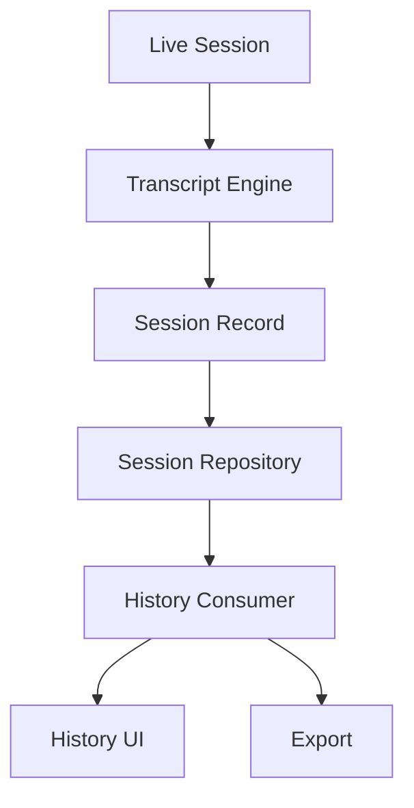
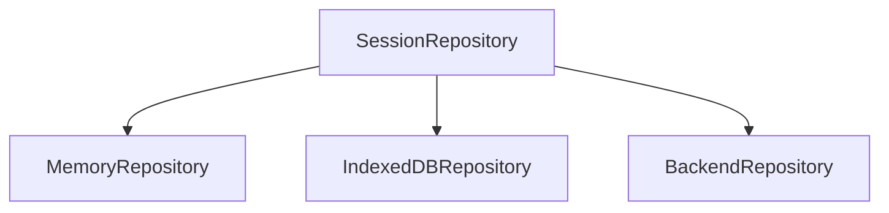

# Session Records Architecture

## Purpose

This document describes the current Session Records architecture and its Phase
2B compatibility role.

It does not discuss:

- UI.
- Storage engine.
- Backend API.
- Access control.

It only discusses:

- Domain model.
- Ownership.
- Repository boundary.
- Lifecycle.
- Future extension.

Session Records provide the current boundary for turning a completed live
translation session into a read-only history record without changing the Gemini
Live session flow, transcript engine, reconnect behavior, token refresh
behavior, or storage infrastructure.

## Phase 0 ownership boundary

Local Supabase on the recording device owns Meeting, Session, Segment, lease,
fence, operation idempotency, and terminal recording lifecycle state. Cloud
Supabase stores only accounts, permissions, meeting settings, dictionaries,
and device/meeting entry data; it is not the recording-data owner. The browser
owns only capture-local durability:
immutable OPFS audio chunks plus durable pending queues for Cue, checkpoint,
operation, and audio delivery. The local service receives chunks explicitly
from the browser and cannot read page OPFS directly. ACK, resend, duplicate
idempotency, and stale-version conflict handling are delivery concerns, not a
second lifecycle owner.

Recovery replays lifecycle operations first, dependent checkpoints/Cues in
sequence/version order second, and audio chunks third. Viewer sharing is
read-only and separate from host export permission. Stop invalidates
Viewer/Recorder shares immediately; the host alone retains completed audio
download and TXT/SRT/VTT export for 30 minutes.

Phase 2B target architecture no longer treats `SessionRecord` as the canonical
future aggregate. `SessionRecord` is the current simplified single-output memory
repository shape and a transitional compatibility shape.

The canonical Phase 2B target is:

```text
Session Aggregate
├── Session
└── SourceTranscript

Translation Aggregate
├── TranslationRequest
├── TranslationExecutions
└── TranslationOutput
```

See [Phase 2B Application Foundation](phase2b-application-foundation.md) and
[Domain Model](domain-model.md).

## Domain Model



The current flow is intentionally one-way:

- A live session emits lifecycle and transcript-domain events.
- The transcript engine owns normalized transcript items.
- The session record captures current session metadata and references transcript
  items.
- The repository abstracts persistence.
- History consumers read finalized records without mutating live-session or
  transcript-engine state.

## Current Ownership

### LiveSession

Responsible for:

- Creating the active session lifecycle.
- Updating lifecycle state during the live session.
- Emitting or exposing enough lifecycle information for record updates.
- Finalizing the session record when the live session reaches a terminal state.

LiveSession must not depend on a concrete storage engine. It should talk only to
the `SessionRepository` boundary or to a narrow session-record coordinator that
uses that boundary.

Phase 2B note: `LiveTranslateSession` is a Gemini/browser-specific
implementation and may later become a `LiveSpeechTranslationPort`
infrastructure adapter. It should not become an Application Service.

### Transcript Engine

Responsible for:

- Creating and updating `TranscriptItem` domain objects.
- Maintaining source and translation stream separation.
- Maintaining `partial` and `final` transcript status.
- Preserving transcript ordering through `sequence`.
- Providing timing fields when available.

The transcript engine is the source of transcript-domain truth. It must not know
where history is stored.

In the Phase 2B target model, transcript items attach to either SourceTranscript
or TranslationOutput through explicit parent ownership. The current
implementation still maps items with `sessionId` plus `stream`.

### Repository

Responsible for:

- Persistence abstraction.
- Creating, updating, finalizing, listing, reading, and deleting session records.
- Attaching transcript items to session records.
- Hiding storage-specific behavior behind a stable interface.

The repository must not depend on UI components, routing, rendering, or export
controls.

This document does not change the existing `SessionRepository` interface or the
current memory-only adapter. Durable storage remains deferred.

Phase 2B repository target:

- `SessionRepository` manages the Session aggregate and SourceTranscript.
- `TranslationRepository` manages the Translation aggregate.
- No `SourceTranscriptRepository`, `TranslationRequestRepository`,
  `TranslationExecutionRepository`, `TranslationOutputRepository`, or
  `ExportArtifactRepository` is introduced in Phase 2B.

### History UI

Responsible for:

- Read-only consumption of finalized session records.
- Requesting list/detail/delete/export actions through domain-facing boundaries.
- Rendering saved session metadata and transcript items.

History UI must not mutate transcript engine state or reopen finalized records
for editing.

## Current Domain Objects and Compatibility Mapping

### SessionRecord

`SessionRecord` represents one current recorded live translation session.

Phase 2B compatibility status:

- Current implementation shape.
- Legacy/transitional compatibility alias.
- Not the canonical target aggregate.
- Must be projected through a Compatibility Adapter into read-model contracts.

Core Domain fields:

- `id`
- `startedAt`
- `endedAt`
- `durationMs`
- `targetLanguageCode`
- `status`
- `failureReason`
- `createdAt`
- `updatedAt`
- `transcriptSummary`

Future Extension fields:

- `failureCategory`
- `lastLifecycleState`
- `targetLanguageLabel`
- `sourceLanguageCode`
- `selectedInputDeviceId`
- `inputDeviceLabelSnapshot`
- `reconnectAttemptCount`
- `hasTranscript`
- `endedBy`
- `storageVersion`
- `appVersion`
- `browserInfo`
- `tokenRefreshCount`
- `networkRecoveryCount`
- `usageLogId`
- `tags`
- `bookmarkCount`
- `ownerUserId`
- `workspaceId`

### TranscriptItem

`TranscriptItem` represents one normalized transcript segment created by the
transcript engine and associated with a session record.

Core Domain fields:

- `id`
- `sessionId`
- `stream`: `source` or `translation`
- `status`: `partial` or `final`
- `text`
- `sequence`
- `startedAt`
- `finalizedAt`
- `languageCode`

Future Extension fields:

- Provider segment identifier, if the Gemini Live event contract exposes one.
- Provider timestamp, if reliable media-aligned timing becomes available.
- Confidence or quality metadata, if explicitly selected later.

Transcript history should store transcript items, not a single combined
transcript string. `TranscriptItem` preserves sequence, stream, status, and
timing, which are required for reliable history detail rendering and export.

Target parent ownership:

- Source items belong to SourceTranscript.
- Translation items belong to TranslationOutput.
- Current `sessionId` plus `stream` mapping remains a compatibility input.

### Phase 2B Target Entities

Domain entities:

- `Session`
- `SourceTranscript`
- `TranslationRequest`
- `TranslationExecution`
- `TranslationOutput`
- `TranscriptItem`

Application DTOs / Read Models:

- `SessionHistoryListItem`
- `SessionDetailDTO`
- `TranslationOutputSummaryDTO`
- `TranslationOutputDetailDTO`
- `TranslationRequestDTO`
- `TranslationExecutionDTO`

React components should consume read models instead of assembling domain
aggregates directly. Legacy `SessionRecord` data should be projected into these
contracts by repository implementation or read-model mapper.

### Repository

`SessionRepository` is the persistence boundary for session records and related
transcript items.

Current implementation:

- `src/lib/sessionRepository.js` defines the method boundary.
- `createMemorySessionRepository()` provides an in-memory adapter for Slice 1B
  validation.
- The memory adapter is not durable storage and does not select `localStorage`,
  IndexedDB, backend storage, a database, or a file format.

Core Domain responsibilities:

- Create session records.
- Update session records.
- Append transcript items.
- Finalize session records.
- List session records.
- Read one session record with transcript items.
- Delete one session record with transcript items.

Future Extension responsibilities:

- Swap storage adapters.
- Support migrations when durable storage is selected.
- Apply retention rules after retention policy is approved.
- Enforce adapter-level delete semantics after storage is selected.

## Current Repository Boundary

`SessionRepository` interface:

```js
{
  createSessionRecord(input),
  updateSessionRecord(id, patch),
  appendTranscriptItem(sessionId, item),
  finalizeSessionRecord(id, patch),
  listSessionRecords(),
  getSessionRecord(id),
  deleteSessionRecord(id)
}
```

Method ownership:

- `createSessionRecord(input)`: Create a new session record after the chosen
  lifecycle creation point.
- `updateSessionRecord(id, patch)`: Apply non-terminal metadata and lifecycle
  updates.
- `appendTranscriptItem(sessionId, item)`: Attach a normalized transcript item
  to the record.
- `finalizeSessionRecord(id, patch)`: Move a record into a terminal state and
  store final summary metadata.
- `listSessionRecords()`: Return lightweight read models for history consumers.
- `getSessionRecord(id)`: Return one record and its transcript items.
- `deleteSessionRecord(id)`: Delete one record and its transcript items.

This interface is the required boundary for repository adapters. Slice 1B adds
an in-memory adapter for deterministic validation, but the architecture still
does not choose a durable storage engine.

Phase 2B Compatibility Adapter rules:

- Compatibility Adapter belongs in repository implementation or read-model
  mapper.
- Compatibility Adapter must not be placed in Application Service.
- Application Service must not depend on the legacy `SessionRecord` storage
  shape.
- Current single-output records must continue to project into Phase 2B read
  models during migration.

## Lifecycle Ownership

```text
create -> active -> update -> finalize -> read -> delete
```

### Create

Owner: LiveSession lifecycle mapping.

The first implementation should create a record after the live session reaches
`listening`. This avoids adding permission-denied or setup-failed attempts to
translation history.

### Active

Owner: LiveSession lifecycle mapping.

The record is considered active while the live session is still producing
transcript items or lifecycle updates. Active records should not be read as
final history and should not be deleted by history consumers.

### Update

Owners: LiveSession lifecycle mapping and Transcript Engine.

LiveSession provides lifecycle metadata such as status, failure reason, and
timestamps. Transcript Engine provides normalized transcript items. A coordinator
or adapter should map those events into repository calls.

### Finalize

Owner: LiveSession lifecycle mapping.

Finalization happens when the session reaches a terminal or manual-recovery
state such as `stopped`, `error`, or `expired`. Finalization sets `endedAt`,
computes `durationMs`, stores final status/failure metadata, and closes the
record for editing.

### Read

Owner: History consumers.

History consumers read finalized records through `listSessionRecords()` and
`getSessionRecord(id)`. Read operations must not mutate live-session,
transcript-engine, or repository state beyond any storage-internal cache that a
future adapter may own.

### Delete

Owner: History consumer through repository boundary.

Delete removes a finalized record and its transcript items through
`deleteSessionRecord(id)`. Delete must not touch the current live session,
Gemini Live connection, transcript engine state, audio resources, or token flow.

## Dependency Rules

- Transcript Engine must not depend on Repository.
- Repository must not depend on UI.
- History UI must not modify Transcript Engine.
- Connection Resilience must not directly operate Repository.
- LiveSession must not depend on a concrete repository adapter.
- SessionRepository adapters must not call Gemini Live APIs.
- Export must consume transcript items and must not mutate session records.
- Storage adapters must not reinterpret raw SDK events; they store domain
  objects only.
- Application Services must not depend on legacy `SessionRecord` storage shape.
- Compatibility Adapter belongs in repository implementation or read-model
  mapper.
- Translation execution failure must not affect Session status.

Connection Resilience may produce failure or retry metadata that Session Records
captures through lifecycle mapping. It must not create, update, finalize, or
delete records directly.

Runtime failures such as provider socket close, microphone disconnect, or
browser suspend must be classified by the Application Layer before they become
domain lifecycle transitions.

## Future Storage



The abstraction and a non-durable memory adapter are defined now.

Future adapters may include:

- `MemoryRepository` for model and repository-boundary validation.
- `IndexedDBRepository` for browser-local durable history.
- `BackendRepository` for server-owned history after access control, retention,
  and privacy rules are approved.

No current architecture decision binds Session Records to `localStorage`,
IndexedDB, backend persistence, a database, or a file format. The memory adapter
must remain replaceable and must not leak into UI, lifecycle wiring, or storage
selection decisions.

## Architecture Decisions

### ADR-001: Session Repository Pattern

Status: Accepted.

Reason: Use a repository boundary to avoid binding Session Records to
`localStorage`, IndexedDB, or backend storage. This keeps the domain model stable
while storage, privacy, retention, and access-control requirements remain
unresolved.

### ADR-002: TranscriptItem Is the Source of Truth

Status: Accepted.

Reason: Store normalized `TranscriptItem` objects instead of one combined
transcript string. This preserves `sequence`, `stream`, `status`, and timing
metadata for history detail views and transcript export.

### ADR-003: History Is Read-Only

Status: Accepted.

Reason: After session finalization, transcript history is review-only.
Disallowing transcript editing keeps the first history capability focused and
prevents unclear ownership between saved records, transcript engine state, and
future editing workflows.

### ADR-004: SessionRecord Is Transitional

Status: Accepted.

Reason: Phase 2B target architecture separates Session/SourceTranscript from the
Translation aggregate. Current `SessionRecord` remains a compatibility shape for
the existing memory repository and single-output UI, but it is not the canonical
future aggregate.

### ADR-005: Compatibility Adapter Placement

Status: Accepted.

Reason: Compatibility mapping belongs in repository implementation or
read-model mapper so Application Services do not depend on legacy storage
details.

## Out of Scope

- Search.
- Bookmarks.
- Usage metrics.
- Diagnostics.
- AI summary.
- Audio storage.
- Token refresh.
- Access control.
- Durable database.
- Event outbox.
- Broker.
- Event replay.
- Raw audio storage.
- Text-to-speech regeneration.
- Billing.
- Multi-tenancy.
- Production deployment concerns.

## Acceptance Criteria

- Domain ownership is clear.
- Repository boundary is clear.
- Lifecycle ownership is clear.
- Future storage is replaceable.
- Architecture does not depend on a specific storage engine.
- Production code is not changed by this architecture document.

## Terminology

Canonical Phase 2B terms:

- Session-oriented Real-time Multilingual Translation Platform
- Application Layer
- SourceTranscript
- TranslationRequest
- TranslationExecution
- TranslationOutput
- Compatibility Adapter

`TranslationJob` is not a canonical domain entity. It may appear only as
proposal history, legacy naming, or transitional compatibility alias and must be
labelled as non-target terminology.
